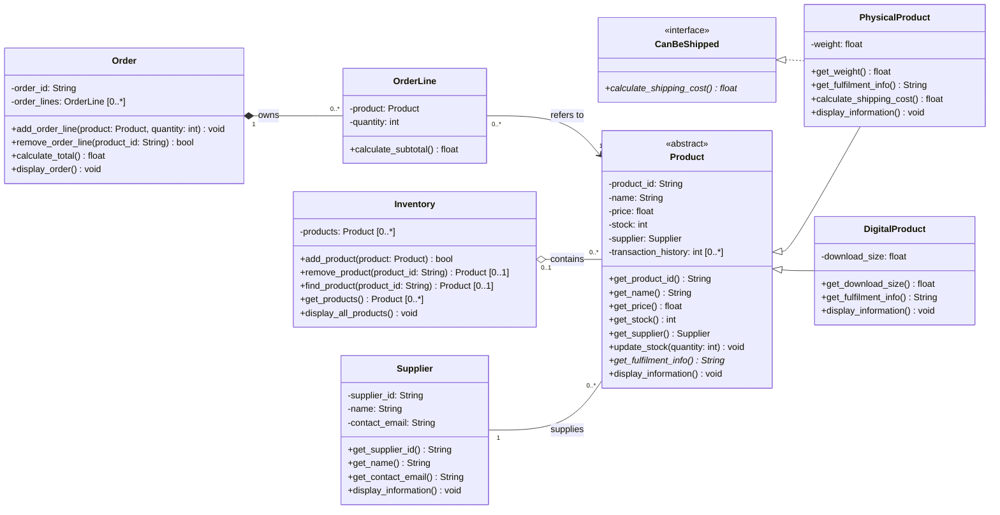

# Lab 8 UML class diagram

Paste the block below into https://mermaid.live to render and export it.

- Association: Supplier 1 —— 0..* Product (plain line)
- Aggregation: Inventory 0..1 ◇—— 0..* Product (hollow diamond)
- Composition: Order 1 ◆—— 0..* OrderLine (filled diamond)
- Association: OrderLine 0..* —— 1 Product
- Inheritance: PhysicalProduct, DigitalProduct ——▷ Product
- Realisation: PhysicalProduct ..▷ CanBeShipped

